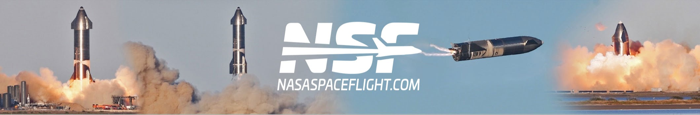

  

  
  
  
  

 

<h2 align="center">🔴 24/7 Live Coverage</h2>

<!-- streams:start -->
<table>
<tr>
<td width="33.3%" align="center" valign="top">
  
    
  
   
  <a href="https://www.youtube.com/watch?v=mhJRzQsLZGg"><b>Starbase Live</b></a>
   
  Development and testing of SpaceX's Starship and Super Heavy at Starbase, TX.
</td>
<td width="33.3%" align="center" valign="top">
  
    
  
   
  <a href="https://www.youtube.com/watch?v=Jm8wRjD3xVA"><b>Space Coast Live</b></a>
   
  24/7 views of launch operations in Florida.
</td>
<td width="33.3%" align="center" valign="top">
  
    
  
   
  <a href="https://www.youtube.com/watch?v=cOmmvhDQ2HM"><b>McGregor Live</b></a>
   
  SpaceX rocket engine testing and development in McGregor, TX.
</td>
</tr>
</table>
<!-- streams:end -->

 

<h2 align="center">📰 Latest from NASASpaceflight.com</h2>

<!-- articles:start -->
<table>
<tr>
<td width="220" align="center" valign="middle"></td>
<td valign="middle">
  <b><a href="https://www.nasaspaceflight.com/2026/11/starship-flight-15-spacex-history/">Starship Flight 15: Ship 42 orbital, Booster diverts to ocean</a></b>
   
  Fri 13 Nov 2026 &middot; Ryan Weber
    
  After 14 full-stack flights, SpaceX was attempting something no one in spaceflight history has done:…
</td>
</tr>
<tr>
<td width="220" align="center" valign="middle"></td>
<td valign="middle">
  <b><a href="https://www.nasaspaceflight.com/2026/11/amazon-leo-lv-01/">ULA’s Vulcan set to return to flight with first Amazon Leo payload</a></b>
   
  Thu 12 Nov 2026 &middot; Justin Davenport
    
  United Launch Alliance’s current flagship launch vehicle, Vulcan, is scheduled to return to flight after…
</td>
</tr>
<tr>
<td width="220" align="center" valign="middle"></td>
<td valign="middle">
  <b><a href="https://www.nasaspaceflight.com/2026/11/isaacman-sls-2030s/">Isaacman lays out SLS path to the 2030s</a></b>
   
  Wed 11 Nov 2026 &middot; Chris Bergin
    
  NASA Administrator Jared Isaacman has further explained the decision to standardize the Space Launch System…
</td>
</tr>
</table>
<!-- articles:end -->

 

<h2 align="center">🚀 Upcoming Launches</h2>

<!-- launches:start -->
<table align="center">
<tr>
<td width="110" align="center" valign="middle"></td>
<td valign="middle">
  <b><a href="https://nextspaceflight.com/launches/details/7425">Amazon Leo (LV-01)</a></b>
   
  United Launch Alliance &middot; Vulcan VC6L
   
  SLC-41, Cape Canaveral SFS, Florida, USA
   
  <b>Sat 14 Nov 2026</b> &middot; 17:32 UTC &middot; window 17:32&ndash;18:01 UTC
</td>
<td width="130" align="center" valign="middle">
  
   
  <a href="https://www.youtube.com/watch?v=qM5A1ZO9oh8">Watch</a> &middot; <a href="https://www.nasaspaceflight.com/2026/11/amazon-leo-lv-01/">Preview</a>
</td>
</tr>
<tr>
<td width="110" align="center" valign="middle"></td>
<td valign="middle">
  <b><a href="https://nextspaceflight.com/launches/details/8335">USSF-317</a></b>
   
  SpaceX &middot; Falcon 9 Block 5
   
  SLC-4E, Vandenberg SFB, California, USA
   
  <b>Wed 18 Nov 2026</b> &middot; 03:14 UTC &middot; window 03:14&ndash;07:14 UTC
</td>
<td width="130" align="center" valign="middle">
  
   
  <a href="https://www.spacex.com/launches/ussf317">Watch</a> &middot; <a href="https://www.nasaspaceflight.com/2026/11/launch-preview-11092026/">Preview</a>
</td>
</tr>
<tr>
<td width="110" align="center" valign="middle"></td>
<td valign="middle">
  <b>USSF-266</b>
   
  SpaceX &middot; Falcon 9 Block 5
   
  SLC-4E, Vandenberg SFB, California, USA
   
  <b>Wed 18 Nov 2026</b> &middot; 16:49 UTC &middot; window 16:49&ndash;20:49 UTC
</td>
<td width="130" align="center" valign="middle">
  
   
  <a href="https://www.spacex.com/launches/ussf266">Watch</a>
</td>
</tr>
</table>

  
  &nbsp;
  

Full schedule, launch history and mission details at <a href="https://nextspaceflight.com">nextspaceflight.com</a>

<!-- launches:end -->

 

<!-- updated:start -->

Last Updated: Sat 14 Nov 2026 at 05:35 UTC

<!-- updated:end -->
